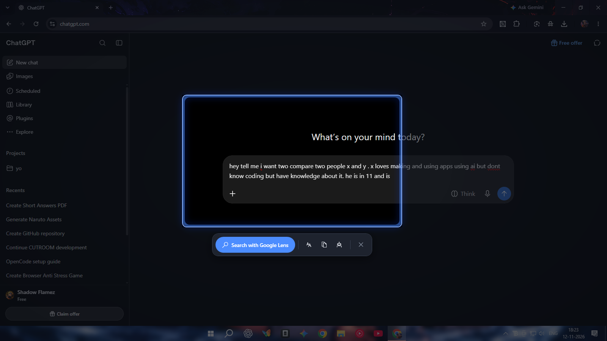
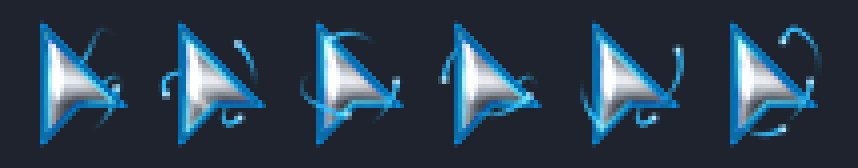

# ShakeLens

A modern Windows tray app that recreates the Googlebook **"Magic Pointer"**
gesture: **shake your mouse cursor**, drag out an area, and send it straight to
**Google Lens**.

Built with **C# / .NET 8 / WPF** - a single small executable, no installer
required and no third party packages.

| | |
| --- | --- |
|  |  |
| The selection frame and the action toolbar | The bundled pointer, six frames of the animation |

<p align="center">
  
</p>

## How it works

| Step | What happens |
| --- | --- |
| Shake the mouse | The screen freezes and dims, a soft vignette appears |
| Drag | The selected area keeps its full brightness and gets a glowing blue frame |
| Release | A dark rounded toolbar slides in under the selection |

The toolbar offers:

- **Search with Google Lens** - the selection is uploaded to Google Lens and
  the visual matches open in your browser.
- **Copy text** - the text inside the selection is read with the Windows OCR
  engine and copied to the clipboard.
- **Copy image** - the selection is copied to the clipboard as an image.
- **Ask AI** - the selection is sent to Gemini, OpenAI or Claude (your own API
  key) and the answer appears in a rounded result panel.

`Win+Shift+G` opens the same selection screen if you do not want to shake the
mouse.

## The gesture

The detector samples the pointer about 250 times a second (the timer
resolution is raised to 1 ms for that) and looks for **quick direction
reversals**:

| Setting | Reversals | Window | Amplitude | Speed |
| --- | --- | --- | --- | --- |
| Light | 3 | 1.0 s | 18 px | 250 px/s |
| Balanced (default) | 4 | 1.0 s | 26 px | 320 px/s |
| Strict | 5 | 1.1 s | 35 px | 420 px/s |

A comfortable hand shake is 3-5 cycles per second, which is 6-10 direction
changes per second - that is what the numbers above are tuned for. Ordinary
mouse movement and small wobbles are ignored, and the detector stands down
while a mouse button is held.

`ShakeLens.exe --selftest` runs the detector against synthetic shakes and
writes the result to `%TEMP%\shakelens_selftest.txt`.

## Highlights

- **Modern UI** - WPF with XAML styling, rounded surfaces, soft shadows,
  Windows 11 style toggle switches and the standard Segoe MDL2 icon glyphs.
- **The Google Lens icon** - the application and tray icon is the Google Lens
  logo, drawn as a vector and stored as a multi size `.ico`
  (16 / 32 / 48 / 256).
- **An animated pointer** - the bundled cursor is the *Azure Chrome Aura*
  arrow: 30 frames at 32 px with the correct hotspot, played back at 12 fps
  while the selection overlay is open.
- **Your own cursor** - drop any `cursor.cur` into
  `%APPDATA%\ShakeLens\cursor.cur` to replace the bundled one.
- **Animated overlay** - the overlay fades in and out, the selection frame
  breathes, the toolbar slides into place and the hint chip floats gently.
- **Google Lens without an API key** - the picture is handed over through a
  temporary local page that posts it to `lens.google.com/v3/upload`, the same
  endpoint the browser uses.
- **Per monitor DPI** - the capture is taken in physical pixels, so mixed
  100 % / 150 % setups work.
- **No NuGet packages** - everything ships with the .NET 8 Desktop Runtime.

## Install

Grab **ShakeLens-Setup-x64.exe** from the
[releases](https://github.com/shadow-flamez-code/ShakeLens/releases) and run it.
It installs to `%LOCALAPPDATA%\Programs\ShakeLens`, adds a start menu and
desktop shortcut and registers an uninstaller. No .NET runtime is needed, the
app ships with everything it requires.

A portable build is available as **ShakeLens-portable-x64.zip** - unpack it
anywhere and run `ShakeLens.exe`.

## Build

```bat
cd ShakeLensWpf
build.cmd
```

Needs the .NET 8 SDK with the Windows Desktop workload. The script publishes a
self contained build, packs it and builds the installer.

## Run

```bat
dist\ShakeLens.exe
```

The app lives in the notification area.

| Tray menu | Meaning |
| --- | --- |
| Search the whole screen with Lens | Captures everything and sends it to Lens |
| React to cursor shakes | Turn the gesture on or off |
| Settings... | Gesture, Lens, AI and system options |
| Start with Windows | Adds a `Run` entry for the current user |
| Exit | Leaves the app |

`ShakeLens.exe --settings` opens the settings window directly.

## Settings

`%APPDATA%\ShakeLens\settings.json` holds everything and can be edited by hand.

| Key | Default | Meaning |
| --- | --- | --- |
| `ShakeEnabled` | `true` | React to cursor shakes |
| `Sensitivity` | `1` | `0` light, `1` balanced, `2` strict |
| `UploadSize` | `1400` | Longest edge of the picture sent to Lens |
| `LensLanguage` | `auto` | Language of the Lens result page |
| `Browser` | `default` | `default`, `chrome`, `edge`, `firefox` |
| `AiProvider` | `none` | `none`, `gemini`, `openai`, `claude` |
| `AiKey` | - | API key for the AI provider |
| `AiModel` | `gemini-2.5-flash` | Model name |
| `AiPrompt` | see below | Instruction sent with the picture |
| `AutoStart` | `false` | Start with Windows |

Default prompt:

> Look at this screenshot. Describe what it shows, transcribe any text you can
> read, and answer any question visible in the image. Be brief.

Free keys: [Google AI Studio](https://aistudio.google.com/apikey).

## Privacy

- The picture is only uploaded when you press **Search with Google Lens**.
- **Copy text** runs locally through `Windows.Media.Ocr`; nothing is sent.
- **Ask AI** sends the selection to the provider you configured.
- The temporary upload page lives in `%TEMP%\ShakeLens` and is cleaned up.

## Project layout

```
ShakeLensWpf/
  build.cmd                 build script
  app.manifest              per monitor DPI and common controls
  Assets/
    ShakeLens.ico           the Google Lens icon (16/32/48/256)
    Cursor/                 the 30 frames of the animated pointer
  tools/
    make-lens-icon.ps1      draws the Google Lens icon into the .ico
    extract-cursor.ps1      pulls the 32 px frames out of the .ani file
  App.xaml                  theme, buttons, inputs, scrollbars
  App.xaml.cs               tray icon, hotkey, detection loop, single instance
  Core/
    Native.cs               capture, cursor, hotkey, DPI helpers
    ShakeDetector.cs        the gesture
    ScreenCapture.cs        capture, crop, scale, PNG
    GoogleLens.cs           hands the picture to Google Lens
    AiService.cs            Gemini / OpenAI / Claude client
    OcrService.cs           Windows OCR through PowerShell
    AppCursor.cs            loads the animated pointer
    Settings.cs             config file and autostart
    TrayIcon.cs             notification area icon
    Theme.cs                colours
  Views/
    OverlayWindow.xaml      selection overlay and toolbar
    ResultWindow.xaml       rounded result panel
    SettingsWindow.xaml     settings
    TrayMenuWindow.xaml     styled tray menu
```

## Credits

* The pointer is the *Azure Chrome Aura* cursor by
  [Cursors-4U.com](https://www.cursors-4u.com), licensed under
  **CC BY-NC 4.0** (non commercial). The frames are extracted from
  `Azure Chrome Aura Cursor Set - Extra Azure Chrome _32-48-64.ani` with
  `tools\extract-cursor.ps1`.
* The icon is the Google Lens logo, redrawn as a vector by
  `tools\make-lens-icon.ps1`.

## Notes

* The OCR engine needs a language pack: *Settings > Time & language >
  Language & region > Language options*.
* The AI features need an API key; everything else works without one.
* The older Win32 version of this app lives in the sibling `ShakeLens`
  folder and can be deleted.
